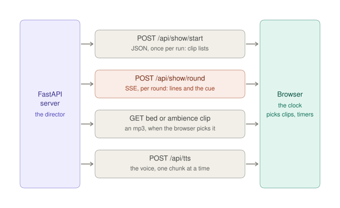
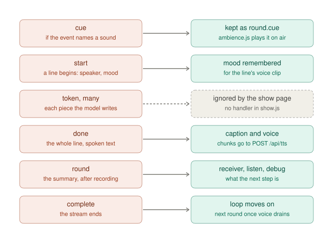
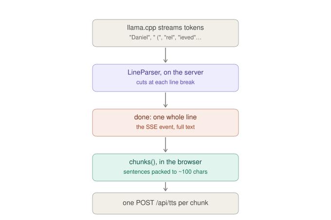

# Between the server and the browser — the four channels, and the round's SSE events

**Date:** 2026-10-12 · **Arc:** MVP prototype · **Branch:** `alfre2v/talk-prep`
**Type:** reference — the agent's answer to the owner's question about how the sounds and the lines travel from the
FastAPI server to the browser, kept exactly as the owner saw it, the two diagrams included. It covers the seam between
[discussion 2026-10-10] code-map-backend and [discussion 2026-10-10] code-map-client. Part 2, the owner's follow-up:
tokens, lines and chunks — where a line and a sentence are cut — and every SSE event over the wire, on a real round.
**Status:** a **snapshot** of the fork at **`tz-0.9`** (`b1d039c`): the line numbers are true there and drift with
every change to the code.

Paths are in the fork, `/Users/alfredo/workspace/hackTNT_2026/TalkWithZombies`.

## The owner's question (verbatim)

> Before we merge the PR. I have a couple of questions about the internal workings of the app, I am not sure I really
> understood these when I studied `docs/discussions/2026-10-10-code-map-backend.md` and
> `docs/discussions/2026-10-10-code-map-client.md`.
> What I want to gain clarity on is how does the change of bed sound, the ambience texture, the ambience stop and the
> cue sounds are transmitted from the fastapi backend to the browser client.
> I "think" they all go via a SSE event, the same mechanism we use to transmit each token as it is received from the
> llama stream, right?
> Please draw me a complete view of how these work, and in any case, how the SSE events work beween server and client.

## The answer

I've confirmed everything in the code. I'll draw two diagrams: first the four channels between the server and the
browser, then the round's SSE stream event by event.

The short answer: **your hypothesis holds for the cue only.** The bed's clip changes, the ambience's textures, its
spots and its silences never travel from the server as events. The browser decides all of those on its own timers. The
server sends the clip lists once, at the start of a run, and afterwards serves the files when the browser asks for
them.



Every channel is started by the browser; the arrows show which way the content travels. The browser is the one that
asks, every time. Where each channel lives in the code:

1. **The start reply** (`app/routers/show.py:156-176`). One JSON reply per run, kept by the page as `show.run`
   (`show.js:182`). It carries:
   - `bed`: the playing clips and the `bed_*` settings (`_bed`, L179);
   - `ambience`: the clips, each with its `kind` (texture or spot) and its `cue_only` flag, plus the `ambience_*`
     settings and the AM filter (`_ambience`, L192).

   After this, the server **never again tells the browser anything** about the bed or the ambience's rotation.
2. **The round's SSE stream** (`show.py:276-399`). One per round. The cue is its only sound-related event (details in
   the next diagram).
3. **The clip downloads** (`show.py:226-241`): `GET /api/show/bed/{name}` and `GET /api/show/ambience/{name}`, which
   are plain `FileResponse`s. They only serve files listed in the manifest, nothing else. The browser triggers them by
   setting an `<audio>` element's `src`:
   - `bed.js:224`: the bed's next clip;
   - `ambience.js:247`: a texture;
   - `ambience.js:303`: a spot, including a cued one.
4. **The voice**, `POST /api/tts`, one request per chunk of a line, made by the player in the page. It doesn't go
   through the SSE stream either. (`POST /api/show/listen` is the fifth door, going the other way: the listener's
   recording goes up and the words come back as JSON.)

**What the browser decides alone**, on its own timers and its own `Math.random` (not the run's seed):
- **The bed:** the shuffle (`bedShuffle`, `bed.js:77`; `bedNext`, L215), the silences (`bedScheduleSilence`, L268),
  the fading (`bedFade`, L299).
- **The ambience's textures:** the shuffle (`ambNext`, `ambience.js:229`), the silences (`ambScheduleSilence`, L362),
  the fading (`ambFade`, L393).
- **The spots:** one every 20-60 s (`ambScheduleSpot`, L279).
- **The levels:** both scripts **wrap `setState`** (`bed.js:327`, `ambience.js:420`). Each time `show.js` changes
  state (thinking, on air, listening, recording, stopped), they adjust: louder between rounds, lower under a line,
  silent while you hold to talk, paused on Stop.

So the "ambience stop" you asked about is the browser too: either a timer's silence, or `setState` saying the page is
recording or stopped. None of it comes from the server.

Here's the round's stream, event by event, with what the page does with each one:



## How the SSE stream works, end to end

**The server side** (`app/routers/show.py`):
- `play_round` (L276) returns a FastAPI `StreamingResponse` wrapped around an **async generator**, `_round_stream`
  (L291), with `media_type="text/event-stream"` and headers that stop anything from buffering (`Cache-Control:
  no-cache`, `X-Accel-Buffering: no`).
- Each `yield` sends one event, formatted by `_sse` (L88) as `data: {json}` plus a blank line. That blank line is what
  ends an event in the SSE format.
- The order inside one round:
  1. `cue`, if any (L349). It's decided **before** any line, by `_cue` (L307), from the planned event.
  2. **The fixed lines** (`plan.before`, L350), such as the event read aloud. Each goes through the same `LineParser`
     as the model's text, so it produces the same `start` / `token` / `done` events, marked `fixed: true` (L337).
  3. **The model's lines**, streamed from llama.cpp (L354). Every token is fed to the parser, which emits `start` when
     a line begins, `token` for each piece, and `done` when the line ends (`parser.py:74, 100, 111`).
  4. After the stream: the round is **recorded** in `script.json` (L383). Only then comes `round`, the summary with the
     kind, `listens`, `receiver`, `cue`, and the rest (L391), followed by `complete` (L399).
- **Failure:** an exception sends `error`, then `complete`, and nothing is recorded (L364-371).
- **Stop:** if the browser aborts (Stop), the generator receives `CancelledError` and **nothing is recorded** (L361).
  That's why Resume replays the round cleanly.

**The browser side** (`static/show/sse.js`, 47 lines):
- The browser's built-in `EventSource` can only do GET, and a round is a POST with a body (`played_s`, the
  transcript). So the page uses `fetch()` and reads the body by hand (`readSSE`).
- `readSSE` takes the bytes as they arrive, appends them to a buffer, and `splitSSE` cuts out the complete `data:`
  lines. Each is parsed as JSON and handed to `onEvent`. A half-received line waits in the buffer for the next network
  chunk.
- The `onEvent` callback is the dispatch in `playRound` (`show.js:255-282`): `start` keeps the mood, `done` speaks the
  line, `cue` is kept, `round` is kept, and `error` fails the round.

## The cue's whole path

1. **Server:** `_cue` (L213) checks the round's event against each clip's keywords (from the story's `ambience.yaml`)
   and picks one with the round's cue dice. It goes out as the round's **first** event:
   `{"type":"cue","file":…,"kind":…}`.
2. **`show.js:275`** only stores it: `round.cue = event`. Nothing plays yet. Lines may still be generating.
3. When the first line's voice starts, `show.js` calls `setState("on air")`. The wrapped `setState` calls `ambFollow`
   (`ambience.js:178`), which sees `state === "on air"` and a cue not yet played (L215). It marks the cue as played and
   calls **`ambCue`** (L321).
4. `ambCue` plays a spot at once, or loads a texture in place of the current one. Either way that means setting an
   `<audio>` element's `src` to `/api/show/ambience/<file>`, **which is the third channel, a plain download**.

So a cue crosses **two** channels: the SSE stream says *which* sound, and a plain GET fetches the sound itself. The
timing comes from the browser, matched to the moment the event is heard rather than the moment it's written.

## One thing you may not have expected

**The `token` events are sent but never used.** The parser emits one per token and the server streams them all, but
`show.js` has no handler for `token`. I searched all of `static/show/` and the designs: nothing reads it. The page
waits for `done`, because it speaks whole lines (cut into chunks of sentences), not tokens.

This is inherited from upstream's chat, where tokens type the reply out live. For the show they're harmless extra bytes
on localhost. So the mechanism *is* the same one that carries tokens, as you thought, but in the show page the tokens
themselves are dead weight.

## Part 2 — Tokens, lines and chunks, and every event over the wire

### The owner's follow-up question (verbatim)

> A follow up question:
>
> #### One thing you may not have expected
>
> `The token events are sent but never used... The page waits for done, because it speaks whole lines (cut into chunks of sentences), not tokens`
>
> Ok, se the server streams each token, which the client ignores, but at certain moments the server streams a `done`
> event, which corresponds to "a sentence completed", I suppose the done event carries in the data the full sentence,
> so the client does not have to join the tokens itself. Correct?
>
> Remind me where is the logic that defines what a sentence is? I remember we did a modification from upstream to
> create an accumulator (default length 100), so short sentences like "Test. 1. 2. 3" do not send many done events
> triggering short bursts of requests to the TTS engine.
>
> Give me a quick picture of how we control the `done` events and show me an example of what a done event looks like.
>
> Actually, let's expand the ask: show me an example (realistic) of how each SSE event between our fastapi server and
> our client looks like over the wire.

### The answer

Your understanding needs one correction before the examples. **`done` closes a *line*, not a sentence.** A line is one
character's whole speech in the screenplay, `Name (mood): words… Over.`, and the server cuts the stream at line breaks.
**The sentence logic and the ~100-character accumulator you remember are in the browser,** in the voice player: the
page cuts each `done` line into chunks before calling the TTS engine.

One more thing from the parser before the examples. Its docstring (`parser.py:7-8`) still says "with streaming TTS the
browser speaks from the `token` events". That's stale. It's true of upstream's chat, but the show page speaks from
`done` (see the previous answer).

Everything is verified. First, a quick picture of where the cuts happen. There are two cutters, one on each side:



### Your two points

1. **"`done` carries the full text, so the client doesn't join tokens."** **Correct.** `done` carries the whole line's
   spoken text (`parser.py:111`: `{"type": "done", "persona": …, "text": line.spoken}`). The page never assembles
   anything from tokens.
2. **"`done` = a sentence completed."** **Not quite. It's one line**, one character's whole turn, cut at the line break
   the grammar forces at the end of every line (`parser.py:64-65`: `if char == "\n": self._end_line(...)`). A line can
   hold several sentences ("A medical team? Over." is two).

### Where "a sentence" and the accumulator live

In the **browser**, `static/show/player.js`. This is the accumulator you remember, ruled on **2026-09-22** (its header
comment, lines 8-11):
- **`sentencesOf(text)`** (L60) cuts a line into sentences. A sentence ends at a run of `.` `!` `?` `…` followed by a
  space or the end of the text. So "3.5", "e.g." and "U.S." stay whole. Upstream's regex cut inside them and sent "Take
  3. 5 milligrams." to the voice (L57-58).
- **`chunks(line)`** (L82) packs whole sentences into chunks, using the constants at L26-32:
  - up to **`chunkMax: 100`** characters;
  - a sentence shorter than **`tailMax: 30`** may **ride along** up to 100 × **`tailTolerance: 1.2`** = **120**
    (that's how the "Over." stays attached);
  - a sentence longer than 100 goes **whole and alone**;
  - a chunk **never crosses a line**, because the next line is another voice.
- Then **80 ms** between chunks of a line, and **250 ms** between lines (`pauseInLineMs`, `pauseBetweenLinesMs`).

Your "Test. 1. 2. 3." case, run through the real `chunks()` in Node, with two lines from your 3090 run:

| The line (length) | Chunks → requests to the voice |
|---|---|
| "Test. 1. 2. 3. Over." (20) | **1**: the whole line. Five tiny sentences, one request |
| Round 54's event line: "A desk phone … in the basement. Over." (104) | **1** (104 chars): the 97-character sentence fills it, and "Over." rides along past 100 because it's under 30 and the total is under 120 |
| Round 93's event line, **plus two short sentences I added to force a split** (131) | **2**: "…like Morse code. It is not random." (106: "It is not random." rode along) and "Someone taught it. Over." (24: adding it would have made 125, over 120) |

### Every SSE event, over the wire (a real round)

This is **round 157** of your run `2026-10-08T14-57-55` on the 3090. The event names a helicopter, so the cue is
`helicopter-1.mp3`, a cue-only spot. What follows is the exact byte stream the server sends, made by running the fork's
own `LineParser`, fed the way `_round_stream` feeds it, through `_sse` copied byte for byte. **Everything is real except
one detail:** the model line's token boundaries are a plausible 12-piece split. The record says the model wrote 12
tokens (`predicted_n: 12`), but the debug file keeps the reply joined, so the real boundaries weren't saved.

The request that opens the stream (`roundBody`, `show.js:86`; no listener this round, so no transcript fields):

```
POST /api/show/round
{"run_id": "2026-10-08T14-57-55", "played_s": 1193.8335374149651}
```

The response, `text/event-stream`, exactly as it arrives. Each event is a `data:` line followed by a blank line:

```
data: {"type": "cue", "file": "helicopter-1.mp3", "kind": "spot"}

data: {"type": "start", "persona": "Ralph", "mood": "happy", "message_id": "2026-10-08T14-57-55-r157-l1", "fixed": true}

data: {"type": "token", "persona": "Ralph", "token": "A helicopter drops a crate marked with a red cross onto the lawn. Over."}

data: {"type": "done", "persona": "Ralph", "text": "A helicopter drops a crate marked with a red cross onto the lawn. Over.", "message_id": "2026-10-08T14-57-55-r157-l1", "fixed": true}

data: {"type": "start", "persona": "Daniel", "mood": "relieved", "message_id": "2026-10-08T14-57-55-r157-l2"}

data: {"type": "token", "persona": "Daniel", "token": "A"}

data: {"type": "token", "persona": "Daniel", "token": " medical"}

data: {"type": "token", "persona": "Daniel", "token": " team"}

data: {"type": "token", "persona": "Daniel", "token": "?"}

data: {"type": "token", "persona": "Daniel", "token": " Over"}

data: {"type": "token", "persona": "Daniel", "token": "."}

data: {"type": "done", "persona": "Daniel", "text": "A medical team? Over.", "message_id": "2026-10-08T14-57-55-r157-l2"}

data: {"type": "round", "n": 157, "kind": "free", "speakers": ["Daniel", "Ralph", "Samantha"], "event": "A helicopter drops a crate marked with a red cross onto the lawn.", "tone": "comradely", "heard": null, "trimmed": [], "dropped": [], "finish_reason": "stop", "listens": false, "receiver": false, "overtone": "positive", "agenda": null, "slot": null, "answers": null, "cue": {"file": "helicopter-1.mp3", "kind": "spot"}, "direction": null}

data: {"type": "complete"}

```

What to notice, event by event:
- **`cue`** comes first, before any line, so the page knows the sound before the event is read aloud.
- **The fixed line** (Ralph reading the event) is fed to the parser **whole**, so it yields one `start`, **one** `token`
  holding the entire text, and one `done`, all marked `"fixed": true`.
- **The model's line:** the tokens of the prefix (`"Daniel"`, `" ("`, `"rel"`, `"ieved"`, `"):"`) produce **no
  events**. The parser holds them until it has seen the whole `Name (mood): ` prefix. `start` fires inside the token
  `" A"`, and the `"A"` after it becomes the first `token`. Spaces are held until the next character, which is why the
  pieces read `" medical"`, `" team"`. The final `"\n"` produces no token, only the `done`.
- **`message_id`** ties a line to its voice: `…-r157-l2` becomes the chunks' place `r157-l2-c1`, `-c2`… (the names of
  the debug audio files).
- **`done.text`** is the *spoken* text. The mood tag is stripped, and typographic punctuation is normalized (`’` → `'`,
  `—` → `, `, and so on: `_SPOKEN`, `parser.py:20`).
- **`round`** comes only after the round is recorded in `script.json`.
  - `"listens": false` and `"receiver": false` because this is a Broadcast free round.
  - `"direction": null` because the story's `cast_sheet.md` has stage directions only for `repair`, `breakdown` and
    `switch-off` (its lines 8-11).
- **`complete`** ends the stream.

The two event types this round doesn't show:
- **`error`**, only when a round fails: `data: {"type": "error", "message": "<the exception's text>"}`, always followed
  by `complete`, and nothing is recorded (`show.py:369-370`).
- **`start` without a mood**: with moods off (a plain-format story), `"mood": null`.

**A stale docstring, found in passing:** `parser.py:7-8` says "with streaming TTS the browser speaks from the `token`
events as they arrive". The show page speaks from `done`. It's the fork's code, so fixing it would be a one-line change
on a fork branch, made only if you want it.
